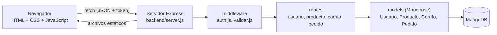
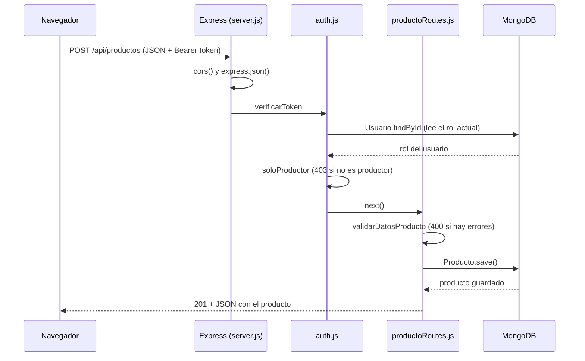
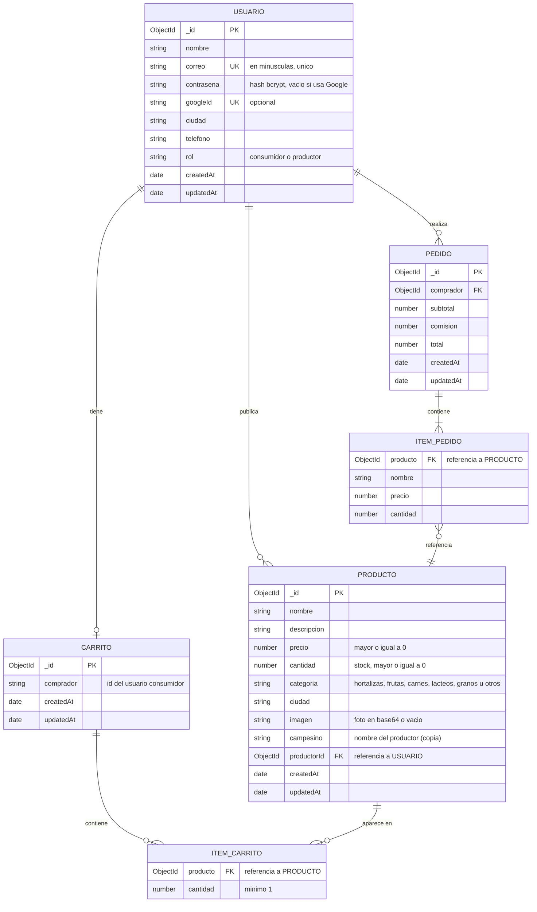

# Modelo general

## Arquitectura cliente-servidor

- **Cliente web** (`frontend/`): páginas HTML con CSS y JavaScript. No tiene lógica de negocio; consume la API de forma asíncrona con `fetch` y adapta la interfaz a la sesión y al rol.
- **Servidor** (`backend/`): API REST con Node.js y Express que responde en JSON. **Además entrega los archivos del front**, así que todo corre en un solo origen (`http://localhost:3000`) y no se necesita configurar CORS para el uso normal. `cors()` está habilitado para permitir consumir la API desde otro origen.
- **Base de datos:** MongoDB, accedida con Mongoose.

## Organización del código del servidor

| Carpeta | Responsabilidad |
|---|---|
| `server.js` | Punto de entrada: configura los middlewares globales (`cors`, `express.json`, archivos estáticos), monta las rutas, el 404 de la API y el manejador de errores. |
| `config/` | Conexión a MongoDB (`db.js`) y estrategia de Google OAuth (`passport.js`). |
| `middleware/` | Lógica que se reutiliza en varias rutas: autenticación y roles (`auth.js`) y validación de ids (`validar.js`). |
| `models/` | Esquemas de datos: `Usuario`, `Producto`, `Carrito` y `Pedido`. |
| `routes/` | Los endpoints de cada recurso y su lógica (validación, consulta a la base de datos y respuesta). No hay una carpeta `controllers`: cada archivo de rutas contiene los manejadores de su recurso. |

Separar así permite cambiar una parte sin tocar las otras: por ejemplo, agregar un rol solo toca `middleware/` y las rutas afectadas, y cambiar la base de datos solo toca `config/` y `models/`.

## Recorrido de una petición

Ejemplo: un productor publica un producto (`POST /api/productos`).

En cualquier punto puede cortarse la cadena con un código de error (401, 403, 400, 500) y el navegador muestra el mensaje al usuario.

## Modelo entidad-relación

### Descripción de las entidades

**Usuario** (colección `usuarios`). Puede registrarse con contraseña (se guarda solo el hash con bcrypt) o con Google (se guarda `googleId` y no hay contraseña). El `rol` solo admite `consumidor` o `productor`. El `correo` es único. El campo `ciudad` permite identificar la ubicación del usuario.

**Producto** (colección `productos`). Es la **entidad principal** del CRUD. `productorId` apunta al usuario dueño: de ahí sale la regla "cada productor solo modifica lo suyo". `categoria` permite filtrar el catálogo. `ciudad` permite identificar la ubicación del producto. `imagen` es una foto reducida guardada como texto base64 (o vacío).

**Carrito** (colección `carritos`). Hay un carrito por consumidor. Sus elementos (`productos`) están **incrustados** dentro del documento: cada uno guarda la referencia al producto y la cantidad. Se muestra en el diagrama como `ITEM_CARRITO` para dejar clara la relación muchos a muchos entre carritos y productos, aunque no es una colección aparte.

**Pedido** (colección `pedidos`). Guarda la información de cada compra realizada por un consumidor, incluyendo los productos comprados y una "foto" de cada producto al momento de la compra, con su nombre y precio. Esta copia permite que los cambios posteriores en los productos del catálogo no alteren la información histórica del pedido. Además, incluye el desglose del subtotal, la comisión y el total de la compra.

### Decisiones de modelado

- **`Producto.campesino` es una copia del nombre del productor.** Evita consultar al usuario cada vez que se lista el catálogo. A cambio hay que mantenerla al día: al editar su perfil, el productor actualiza el nombre en todos sus productos.
- **`Carrito.comprador` es un texto con el id del usuario**, no una referencia de Mongoose. Funciona igual para identificar al dueño del carrito, aunque no permite usar `populate` sobre ese campo.
- **Las fotos viven en la base de datos** (base64) para que el proyecto se ejecute sin servicios externos ni carpetas de archivos que compartir.
- **`correo` y `googleId` son únicos**: el primero evita cuentas duplicadas; el segundo (con índice `sparse`) permite que los usuarios sin Google no choquen entre sí.
